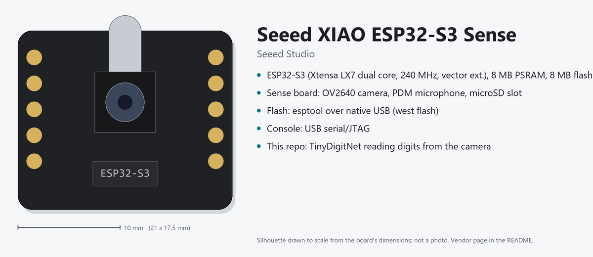
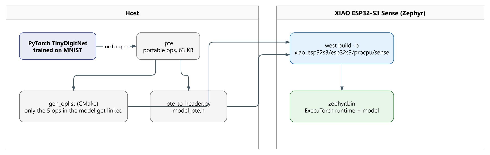
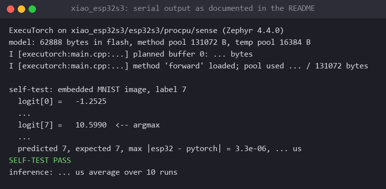
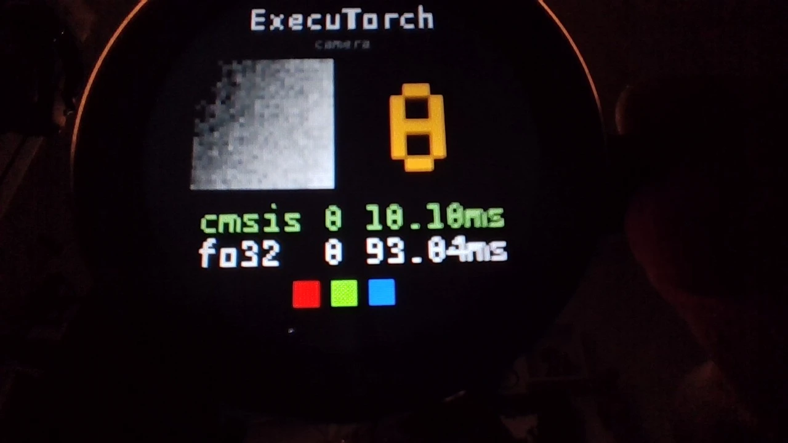
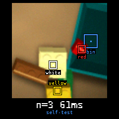

# ExecuTorch on the XIAO ESP32S3 Sense with Zephyr

Train a PyTorch model, export it with [ExecuTorch](https://github.com/pytorch/executorch),
and run it on a Seeed Studio **XIAO ESP32S3 (Sense)** under **Zephyr RTOS** using the
[ExecuTorch Zephyr module](https://docs.zephyrproject.org/latest/develop/manifest/external/executorch.html).



*Board overview source: [docs/diagrams/board.drawio](docs/diagrams/board.drawio), editable in draw.io.*

The upstream module and its `hello-executorch` sample are written around Arm Cortex-M and
Ethos-U. This repo shows the same module building for an **Xtensa LX7** part with no Arm
pieces at all: fp32 portable kernels, selective operator linking, the model embedded in
flash, and an optional live loop that classifies frames from the Sense board's OV2640
camera.



*Diagram source: [docs/diagrams/overview.drawio](docs/diagrams/overview.drawio), editable in [draw.io](https://www.drawio.com/); re-export to `docs/images/overview.png`.*

## What you get

| Piece | Where | Notes |
|---|---|---|
| Model + training | `train/model.py`, `train/train_mnist.py` | 14 410 params, ~97.5 % MNIST after 2 CPU epochs |
| Export to `.pte` | `train/train_mnist.py` (`export_pte`) | `to_edge_transform_and_lower` with no delegate |
| Host sanity check | `train/run_pte_host.py` | runs the `.pte` with the ExecuTorch Python runtime |
| Zephyr app | `firmware/` | self-test on an embedded MNIST image, then optional camera loop |
| Workspace manifest | `west.yml` | Zephyr v4.4.0 + `hal_espressif` + ExecuTorch v1.5.1 as a module |
| Brick detector | `train/lego_*.py`, `firmware/src/lego.cpp`, `tools/` | second application: bricks by colour for an arm, section 8 |
| CI | `.github/workflows/build.yml` | trains smoke models and builds every firmware variant |

Pre-built outputs are committed so you can flash without training:
`firmware/model/mnist_tiny.pte` and `firmware/src/test_input.h`.

## Hardware

- Seeed Studio XIAO ESP32S3 Sense (ESP32-S3R8, 8 MB flash, 8 MB PSRAM, OV2640 camera, PDM mic).
  The plain XIAO ESP32S3 works for everything except the camera mode.
- USB-C cable. Flashing is over the native USB-serial, no extra adapter.

Zephyr board targets:

| Target | Use |
|---|---|
| `xiao_esp32s3/esp32s3/procpu` | plain board, self-test only |
| `xiao_esp32s3/esp32s3/procpu/sense` | Sense board, self-test; add `camera.conf` for the live loop |

## Quick start

### 1. Host setup

Python 3.12 or 3.13 on Linux or macOS (WSL2 is fine). One venv serves training, export and
`west`, because the firmware build calls ExecuTorch's `codegen.tools.gen_oplist` at
configure time to work out which kernels to link.

```bash
python3 -m venv .venv && source .venv/bin/activate
pip install -r requirements.txt --extra-index-url https://download.pytorch.org/whl/cpu
```

### 2. Train and export

```bash
python train/train_mnist.py            # ~1-2 min on CPU, downloads MNIST (~10 MB)
python train/run_pte_host.py           # optional: run the .pte on the host
```

`train_mnist.py` writes:

- `firmware/model/mnist_tiny.pte`, the ExecuTorch program. The operator list it prints
  is exactly what gets linked into the firmware:
  `aten.convolution.out`, `aten.max_pool2d_with_indices.out`, `aten.relu.out`,
  `aten.permute_copy.out`, `aten.addmm.out`.
- `firmware/src/test_input.h`, one MNIST test image (label 7) and the PyTorch logits for
  it, so the board can prove end-to-end numerical agreement on first boot.

To use your own model: keep the input as a single fp32 tensor, export the same way, and point
the build at it with `-DET_PTE_FILE_PATH=/path/to/model.pte`. Anything the portable kernel
library implements will link; there is no Xtensa backend, so quantised graphs would need the
quantized kernel library added to the selective build (see "Going further").

### 3. Zephyr workspace

The manifest in this repo creates a minimal workspace: Zephyr, the Espressif HAL and
ExecuTorch (as `modules/lib/executorch`). Do this in an empty directory, with the venv
active.

```bash
west init -m https://github.com/eoinjordan/executorch-zephyr-xiao-esp32s3 ws
cd ws
west update                          # ExecuTorch has large submodules; a few minutes
west blobs fetch hal_espressif       # Espressif binary blobs (Wi-Fi/BT libs, needed to link)
west sdk install --toolchains xtensa-espressif_esp32s3_zephyr-elf
```

If you already have a Zephyr workspace, copy `modules/lib/executorch` registration from
`west.yml` into `zephyr/submanifests/executorch.yaml` instead, as the Zephyr docs describe,
and add `+executorch` to your `manifest.project-filter`.

### 4. Build, flash, watch

```bash
cd ws
west build -p always -b xiao_esp32s3/esp32s3/procpu/sense executorch-zephyr-xiao-esp32s3/firmware
west flash
west espressif monitor
```

Expected serial output (abridged):

```
ExecuTorch on xiao_esp32s3/esp32s3/procpu/sense (Zephyr 4.4.0)
portable   62888 bytes in flash,  52928 planned, pool  59584 of  73728 bytes used
cmsis-nn   22344 bytes in flash,   6768 planned, pool  14688 of  32768 bytes used

portable self-test: embedded MNIST image, label 7
  ...
  logit[7] =   10.5990  <-- argmax
  ...
  predicted 7, expected 7, max |esp32 - pytorch| = 2.86e-06 (limit 1.00e-03)
portable SELF-TEST PASS
portable inference: 92741 us average over 10 runs

cmsis-nn self-test: embedded MNIST image, label 7
  ...
  predicted 7, expected 7, max |esp32 - pytorch| = 4.77e-07 (limit 3.75e-01)
cmsis-nn SELF-TEST PASS
cmsis-nn inference: 9306 us average over 10 runs

int8 on CMSIS-NN is 9.96x the speed of fp32 on the portable kernels, in 35% of the flash
```



*The serial output above, rendered.*

If the chip stays in download mode after flashing, use `west flash --reset-type watchdog-reset`.

### 5. Live camera mode (Sense board)

```bash
west build -p always -b xiao_esp32s3/esp32s3/procpu/sense executorch-zephyr-xiao-esp32s3/firmware -- -DEXTRA_CONF_FILE=camera.conf
west flash && west espressif monitor
```

The firmware streams 160x120 RGB565 from the OV2640 through Zephyr's video API, centre-crops
to 120x120, box-downsamples to 28x28, inverts (MNIST digits are light on dark, so write a dark
digit on white paper), normalises with the training mean and std, and classifies once a
second. It prints a 28x28 ASCII preview of what the model saw next to each prediction, which
is the quickest way to tune framing and lighting. If the preview looks like noise, set
`CONFIG_APP_CAMERA_SWAP_BYTES=y`.

This is a demonstration of the sensor-to-tensor path, not a robust digit reader: the model was
trained on MNIST, so expect it to be picky about stroke width and contrast.

### 6. CMSIS-NN kernels on the ESP32-S3

The firmware embeds the network twice: `mnist_tiny.pte` in fp32 on the portable kernels,
and `mnist_tiny_cmsis_nn.pte` in int8 on ExecuTorch's `cortex_m` operators, which call
CMSIS-NN. CMSIS-NN is Arm's library, and the ESP32-S3 is an Xtensa LX7. It works because
CMSIS-NN has a plain C code path beside its DSP and Helium ones, and nothing in ExecuTorch's
Cortex-M backend needs an Arm core. Three things make it build here:

- `train/export_cmsis_nn.py` quantises with the `CortexMQuantizer` and targets the plain C
  path (`CortexMTargetConfig(cpu=CortexM.M0PLUS)`, the backend it calls `SCALAR`). The model
  is exported in channels-last layout: in the default layout the quantizer leaves every
  convolution in float.
- `firmware/CMakeLists.txt` sets `EXECUTORCH_BUILD_CORTEX_M` before the Zephyr module is
  read, because the module only turns the backend on for `CONFIG_CPU_CORTEX_M`.
- `west.yml` adds Zephyr's `cmsis-nn` module to the workspace, which the ExecuTorch build
  picks up.

```bash
python train/export_cmsis_nn.py     # after train/train_mnist.py
```

Measured on a XIAO ESP32S3 Sense at 240 MHz, Zephyr 4.4.0, ExecuTorch 1.5.1, built with
`CONFIG_SPEED_OPTIMIZATIONS=y`. The console is in [docs/console-cmsis-nn.txt](docs/console-cmsis-nn.txt).

| | fp32, portable kernels | int8, CMSIS-NN (plain C) |
|---|---|---|
| Program in flash | 62,888 bytes | 22,344 bytes |
| Planned tensor memory | 52,928 bytes | 6,768 bytes |
| Method pool used | 59,584 bytes | 14,688 bytes |
| Inference, average of 10 | 92.7 ms | 9.3 ms |
| Self-test against PyTorch | 2.9e-06 | 4.8e-07 (quantised reference) |
| MNIST test accuracy (PyTorch, 10,000 images) | 97.46 % | 97.46 % |

The int8 program is 10 times as fast in 35 % of the flash. The portable kernels are
reference implementations, which is most of that gap; CMSIS-NN in plain C uses no SIMD
either, so this is not the ceiling for the chip.

`-DAPP_CMSIS_NN=OFF` builds the firmware with the fp32 program only, as before.

### 7. Round display



*The display on the board while the firmware runs: camera crop, digit, and one line per program with its time.*

With the [Seeed Studio Round Display for XIAO](https://wiki.seeedstudio.com/get_start_round_display/)
(GC9A01, 240 x 240) under the board, the firmware shows what the model is given, the digit,
and the time each program took:

```bash
west build -p always -b xiao_esp32s3/esp32s3/procpu/sense --shield seeed_xiao_round_display \
  executorch-zephyr-xiao-esp32s3/firmware -- \
  "-DEXTRA_CONF_FILE=camera.conf;display.conf" -DEXTRA_DTC_OVERLAY_FILE=round_display.overlay
west flash && west espressif monitor
```

The picture is drawn in bands of 40 rows, so the screen costs 19 KiB of RAM where a frame
buffer would cost 115 KiB. This build uses 586,244 bytes of flash and 373,080 of the
399,108 bytes of internal RAM (camera buffers, both programs, the band). Three squares at
the bottom must be red, green and blue from left to right; if they are not, set
`CONFIG_APP_SCREEN_SWAP_BYTES=n`. The camera crop is contrast-stretched before it is
inverted, so plain paper stays dark.

Windows: with size optimisation GCC uses the size-optimised libstdc++ headers, whose path
in the ESP32-S3 toolchain is longer than the 260 characters Windows allows by default. The
firmware builds for speed, which avoids them.

### 8. Bricks by colour for a pick-and-place arm



*What the firmware drew for its embedded synthetic test picture, read back from the board over USB. It is not a photograph of bricks.*

A second application in the same firmware tree, chosen with `lego.conf`. The board rides on
the gripper of an arm, lens along the fingers, and tells a host where the bricks are: it
finds yellow, white and red LEGO bricks and a blue parts bin in the camera picture, marks
them on the round display, and prints one line per frame on the USB console. Moving the arm
is the host's job and is not in this repo.

The model is BrickNet (`train/lego_model.py`), a fully convolutional centroid detector in
the style of FOMO. A 96 x 96 RGB picture goes through one 3 x 3 convolution and five
depthwise-separable blocks, three of them at the final 12 x 12 resolution, and a 1 x 1
convolution gives each of the 144 cells five logits: background, yellow, white, red, bin.
Touching cells of one class are one object; its centroid is the target. 5,717 parameters.

**There is no real dataset yet.** The network is trained only on pictures drawn by
`train/lego_synth.py`: bricks as boxes with studs, side faces and shadows, an open blue
box, desks (pale, wood, grey, black, a cutting mat), lighting colour casts, exposure, blur,
noise, and things that are not targets (skin, wood, orange, green, grey, paper, gripper
fingers, bricks in other colours). Every score below is for such pictures. Nothing here
measures how well it finds real bricks on a real desk; that needs the pictures of
"Real pictures and fine-tuning" below.

#### Train, export, build, flash

```bash
python train/train_lego.py       # 16,000 synthetic pictures, 24 epochs, CPU only
python train/export_lego.py      # both .pte files and firmware/src/lego_test_input.h
west build -p always -b xiao_esp32s3/esp32s3/procpu/sense --shield seeed_xiao_round_display \
  executorch-zephyr-xiao-esp32s3/firmware -- \
  "-DEXTRA_CONF_FILE=camera.conf;display.conf;lego.conf" -DEXTRA_DTC_OVERLAY_FILE=round_display.overlay
west flash && west espressif monitor
```

The exported programs and the test header are committed, so the build works without
training. `lego.conf` also turns on the 8 MB of PSRAM (the fp32 program works there) and
`CONFIG_APP_CAMERA_SWAP_BYTES`, without which the camera's RGB565 comes out as coloured
noise. The digit demo is untouched: without `lego.conf` the firmware is the one of sections
4 to 7.

At start-up the firmware runs both programs on a synthetic picture that is baked in and
compares the logits with PyTorch, then detects in camera frames with the int8 program
(`CONFIG_APP_LEGO_LIVE_FP32=y` for the fp32 one). From
[docs/console-lego.txt](docs/console-lego.txt):

```
portable   32532 bytes in flash, 184320 planned, pool 192816 of 393216 bytes used, float NCHW input
cmsis-nn   29316 bytes in flash,  46192 planned, pool  58616 of  81920 bytes used, int8 NHWC input

portable self-test: embedded synthetic picture, 3 bricks and the bin
  DET n=3 yellow 0.48 0.92 1.00 red 0.74 0.49 1.00 white 0.44 0.65 0.99 bin 0.83 0.40 1.00 ms=724
  found 3 bricks and the bin, max |esp32 - pytorch| = 1.41e-05 (limit 1.00e-03)
portable SELF-TEST PASS
cmsis-nn self-test: embedded synthetic picture, 3 bricks and the bin
  DET n=3 yellow 0.48 0.92 1.00 red 0.74 0.49 1.00 white 0.43 0.65 0.98 bin 0.83 0.40 1.00 ms=62
  found 3 bricks and the bin, max |esp32 - pytorch| = 4.27e-01 (limit 8.53e-01)
cmsis-nn SELF-TEST PASS
```

#### The line for the host

```
DET n=2 yellow 0.42 0.61 0.93 red 0.70 0.33 0.88 bin 0.15 0.20 0.97 ms=41
```

| Field | Meaning |
|---|---|
| `n=<count>` | bricks that follow, 0 to 8, the most confident first |
| `<colour> <x> <y> <conf>` | one per brick; colour is `yellow`, `white` or `red` |
| `bin <x> <y> <conf>` | only when the bin is in view; the largest blue patch |
| `ms=<time>` | the inference in milliseconds |

`x` and `y` are the centroid in the picture the model sees, the centre square of the camera
frame: `x` from 0 at the left to 1 at the right, `y` from 0 at the top to 1 at the bottom.
`conf` is the highest class probability among the cells of the object, 0.60 to 1.00; cells
below 0.60 are dropped on the board, and the host can ask for more.

`tools/lego_reader.py` parses these lines and picks the next target: the brick nearest to
the point where the gripper closes, or the bin when a brick is held, skipping bricks that
already lie in the bin. It is a starting point for the arm side and has not driven an arm.

```bash
python tools/lego_reader.py --demo        # parse the example line, no board needed
python tools/lego_reader.py               # print the target for each frame from the board
```

#### Scores on synthetic pictures

2,000 held-out pictures from the generator with another seed, decoded as on the board
(threshold 0.60). An object counts as found when a detection of its class has its centroid
within 1.5 cells of the true one, or within half the size of the object if that is more.

| Class | Objects | fp32 precision | fp32 recall | int8 precision | int8 recall | Centroid error |
|---|---|---|---|---|---|---|
| yellow | 1,601 | 0.83 | 0.84 | 0.83 | 0.84 | 0.31 cells |
| white | 1,597 | 0.53 | 0.64 | 0.52 | 0.63 | 0.48 cells |
| red | 1,579 | 0.88 | 0.84 | 0.89 | 0.84 | 0.29 cells |
| bin | 877 | 0.90 | 0.94 | 0.90 | 0.94 | 0.37 cells |

The two cases that are hard for colour, int8 model, precision / recall:

| Pictures | yellow | white | red | bin |
|---|---|---|---|---|
| pale desk (562) | 0.87 / 0.83 | 0.48 / 0.50 | 0.91 / 0.85 | 0.96 / 0.96 |
| warm light (614) | 0.79 / 0.82 | 0.55 / 0.60 | 0.84 / 0.82 | 0.93 / 0.93 |
| pale desk under warm light (175) | 0.85 / 0.82 | 0.51 / 0.49 | 0.87 / 0.84 | 0.92 / 0.95 |

White is the weak class even here. Its false detections are paper, grey things and the
pale parts of other objects, which the generator draws on purpose and which a detector
that mostly sees colour cannot tell from a white brick in dim light. Quantising costs
nothing measurable. A stricter threshold trades recall for precision (fp32, 750 other
synthetic pictures):

| Threshold | yellow | white | red | bin |
|---|---|---|---|---|
| 0.5 | 0.80 / 0.82 | 0.47 / 0.66 | 0.86 / 0.85 | 0.89 / 0.93 |
| 0.6 | 0.82 / 0.81 | 0.53 / 0.63 | 0.88 / 0.84 | 0.90 / 0.93 |
| 0.7 | 0.85 / 0.81 | 0.60 / 0.55 | 0.89 / 0.84 | 0.90 / 0.93 |
| 0.8 | 0.88 / 0.79 | 0.68 / 0.48 | 0.90 / 0.81 | 0.91 / 0.92 |
| 0.9 | 0.92 / 0.75 | 0.78 / 0.34 | 0.92 / 0.79 | 0.92 / 0.91 |

`tools/lego_reader.py` only acts on bricks with `conf` of 0.80 or more.

#### Real pictures and fine-tuning

`tools/lego_capture.py` asks the running firmware for frames over the USB console (it finds
the port by the Espressif USB vendor id) and files them by label. The frame is the 96 x 96
picture the model was given, and the `DET` line of the same frame is logged next to it.

```bash
python tools/lego_capture.py --label background --count 30     # no brick, no bin in view
python tools/lego_capture.py --label yellow --count 30         # only yellow bricks in view
python tools/lego_capture.py --label white --count 30
python tools/lego_capture.py --label red --count 30
python tools/lego_capture.py --label bin --count 30
python tools/lego_capture.py --screen screen.png               # what the display shows
python tools/lego_capture.py --console console.txt --info      # the start-up report again

python train/lego_predict.py data/lego/real/yellow --sheet sheet.png   # host model against the board
python train/finetune_lego.py                                  # then export_lego.py and rebuild
```

Pictures land in `data/lego/real/<label>/`, which git ignores. A folder name is a weak
label: `background` means every cell is background, a colour means the cells are that
colour or background and at least one is the colour. For exact targets put `<picture>.txt`
next to a picture with one `class x y [radius]` per object. `finetune_lego.py` mixes the
real pictures half and half with synthetic ones and prints, per folder, how many pictures
the model reads as labelled before and after. Move the camera, the light and the bricks
between captures, and keep some folders out of training to measure with.

What was checked with real frames so far, and it is little: 12 frames from the board with
no brick and no bin in view, in a dim room, out of focus. On those the board reported no
bricks at all and a bin in one frame (confidence 0.62); over a 20 second run of 124 frames
it reported no bricks and a bin in 8 (0.60 to 0.72). The host model run on the 12 captured
frames gave the same line as the board for 10; the other two sit on the 0.60 threshold,
where the integer kernels and PyTorch round differently. The colour order of the camera
was judged by eye from those scenes, not with a colour chart. No picture of a real brick
or bin has been through the model, and the fine-tune script has only been run on those 12
background frames and on synthetic stand-ins for the other folders.

#### Memory and timing

Measured on a XIAO ESP32S3 Sense with the round display, Zephyr 4.4.0, ExecuTorch 1.5.1,
`CONFIG_SPEED_OPTIMIZATIONS=y`, the firmware of this section.

| | fp32, portable kernels | int8, CMSIS-NN (plain C) |
|---|---|---|
| Program in flash | 32,532 bytes | 29,316 bytes |
| Planned tensor memory | 184,320 bytes | 46,192 bytes |
| Method pool used | 192,816 bytes, in PSRAM | 58,616 bytes, internal RAM |
| Inference, average of 10 | 724 ms | 60.2 ms |
| Self-test against PyTorch | 1.4e-05 | 0.43, four steps of the output scale |

The whole image is 487,976 bytes of flash and uses 386,616 of the 399,108 bytes of internal
RAM (camera buffers, the int8 program, the display band), plus a 1 MB heap in PSRAM. The
camera loop, with inference, the `DET` line and a redraw of the display, ran at 6.2 frames
a second. The int8 program is the default: 12 times as fast, with scores within 0.01 of fp32.

The fp32 time includes working out of PSRAM, which is slower than internal RAM; the
network does not fit there in float.

#### Limits

- Trained on synthetic pictures only. Expect to need real pictures before it is useful on
  a desk, white bricks most of all.
- It keys on colour. Anything yellow, red, white or blue of brick size will be reported;
  a blue brick reads as a bin.
- Two bricks of one colour that touch are one object with one centroid.
- Objects smaller than a cell (8 pixels of the 96) are often missed; move the camera in.
- The picture is the centre square of a 160 x 120 frame. There is no calibration from
  picture coordinates to arm coordinates, and the picture is not rotated for the way the
  board is mounted.
- The OV2640 runs with its automatic exposure and white balance.

## Verify

Three checks, each proving one stage of the pipeline:

1. **Export is faithful.** `python train/run_pte_host.py` runs the committed `.pte` with the
   ExecuTorch Python runtime and asserts the logits match the PyTorch reference in
   `firmware/src/test_input.h` to within 1e-3 (measured: 3.3e-06).
2. **Firmware builds.** `west build` for the three variants in `.github/workflows/build.yml`
   finishes with the Zephyr memory report and no warnings from the ExecuTorch tree.
3. **Runs without hardware.** The app also builds for `native_sim/native/64`
   (`west build -b native_sim/native/64 executorch-zephyr-xiao-esp32s3/firmware`, then run
   `build/zephyr/zephyr.exe`) to try the same self-test on your PC.
4. **Device agrees with the host.** The serial log shows `SELF-TEST PASS`, which requires the
   predicted class to equal the embedded label and the ESP32's logits to match PyTorch to
   within 1e-3.

## How the firmware is put together

`firmware/CMakeLists.txt` mirrors the upstream `zephyr/samples/hello-executorch` layout but
drops everything Arm-specific:

- `CONFIG_EXECUTORCH=y` in `prj.conf` turns on the module (`modules/lib/executorch/zephyr`),
  which builds `executorch_core` with the Zephyr PAL and links it as `libexecutorch`.
- `CONFIG_EXECUTORCH_BUILD_PORTABLE_OPS=n` stops the module linking every portable operator.
  The app instead calls `arm_runner_create_selected_ops_lib` (despite its name a target-agnostic
  wrapper over `gen_selected_ops` / `gen_operators_lib`) with `OPS_FROM_MODEL` pointing at the
  `.pte`, so only the kernels the model needs end up in the image.
- `scripts/pte_to_header.py` turns the `.pte` into a 16-byte aligned `const uint8_t[]` in
  `.rodata`. On the ESP32-S3 that is memory-mapped flash, so the model costs no SRAM: the
  runtime reads it in place through a `BufferDataLoader`.
- `src/main.cpp` allocates two static pools (method and temp), loads the `Program`, sizes the
  memory-planned buffers from `MethodMeta`, loads the `Method` once and reuses it for every
  inference. Timing uses `k_cycle_get_32`.
- `src/camera.c` is plain C against `zephyr/drivers/video.h` and is only compiled with
  `CONFIG_APP_CAMERA` (set by `camera.conf`).

Differences from the Arm sample worth knowing about if you compare the two:

| Arm `hello-executorch` | This sample | Why |
|---|---|---|
| `CONFIG_FP_HARDABI=y` | omitted | Arm-only Kconfig; `CONFIG_FPU=y` is enough for the LX7 FPU |
| `cortex_m_ops_lib`, CMSIS-NN | omitted | no such backend for Xtensa |
| `arm_memory_allocator.cpp` | `MemoryAllocator` from the runtime | the Arm helper only adds usage statistics |
| `pte_to_header.py --section network_model_sec` | own script, plain `.rodata` | the custom section name is only placed by the Arm linker scripts |
| copies the model into SRAM for the NPU DMA | reads it from flash | no DMA engine needs it |

## Memory and performance

Measured with the committed model, Zephyr v4.4.0, ExecuTorch v1.5.1, Zephyr SDK 1.0.1
(xtensa-espressif gcc 14.3), `-Os`. From the linker's memory report:

| Region | self-test build | with `camera.conf` | Notes |
|---|---|---|---|
| FLASH image (`zephyr.bin`) | 398 716 B | 404 124 B | runtime + 5 kernels + 63 KB model |
| `dram0_0_seg` (SRAM) | 251 208 B / 399 108 B | 363 888 B / 399 108 B | includes the 128 KB method pool, 16 KB temp pool, 32 KB heap, 16 KB main stack; camera adds 80 KB of frame buffers |
| `iram0_0_seg` | 35 396 B | 47 088 B | |
| `irom0_0_seg` (code in flash) | 140 151 B | 155 427 B | |
| `drom0_0_seg` (rodata in flash) | 333 180 B | 338 588 B | the `.pte` lives here |

Only the five operator kernels used by the model are linked; `zephyr.map` lists
`op_addmm`, `op_convolution`, `op_max_pool2d_with_indices`, `op_permute_copy` and
`op_relu` from `libportable_kernels.a` and nothing else.

The method pool is generous for this model. The boot log prints `planned buffer 0: N bytes`
and `pool used X / Y`; set `CONFIG_EXECUTORCH_METHOD_ALLOCATOR_POOL_SIZE` a little above X
if you need the SRAM back.

The `inference:` line in the boot log is the number to compare against other runtimes on the
same board.

## Going further

- **Quantise.** Export an int8 graph with `XNNPACKQuantizer`-style PT2E quantisation and add
  `kernels/quantized/quantized.yaml` as a second `arm_runner_create_selected_ops_lib` call
  (the module already builds `quantized_kernels`). Expect roughly 4x smaller weights and a
  solid speed-up from the LX7's SIMD-ish integer paths.
- **Bigger inputs.** Raise `CONFIG_EXECUTORCH_METHOD_ALLOCATOR_POOL_SIZE` (the planned buffer
  size is printed at boot) and, for anything beyond a few hundred KB, put the pool in PSRAM
  with the `espressif-psram-8M` snippet.
- **Audio.** The Sense board's PDM mic is on GPIO41/42; Zephyr's `dmic` API plus a KWS model
  exported the same way is the natural next sample.
- **Upstream.** `firmware/` is laid out to drop into `zephyr/samples/` in the ExecuTorch repo.
  See `docs/upstream-pr.md`.

## Troubleshooting

- `ExecuTorch module not found`: `west list executorch` must show
  `modules/lib/executorch`. Re-run `west update`.
- `No module named codegen` / `gen_oplist` errors at configure time: the `executorch` pip
  package is not in the Python that `west` is using. Activate the venv from step 1.
- Link errors about Espressif Wi-Fi/BT symbols: run `west blobs fetch hal_espressif`.
- `Could not allocate memory for memory planned buffer`: raise
  `CONFIG_EXECUTORCH_METHOD_ALLOCATOR_POOL_SIZE` in `prj.conf`.
- `Missing operator` at runtime: the `.pte` used at build time differs from the one you
  flashed, or the model uses an op the portable library lacks. Rebuild with `-p always` and
  check the operator list printed by `train_mnist.py`.

## License

Apache-2.0. See [LICENSE](LICENSE). ExecuTorch is BSD-3-Clause and Zephyr is Apache-2.0.
